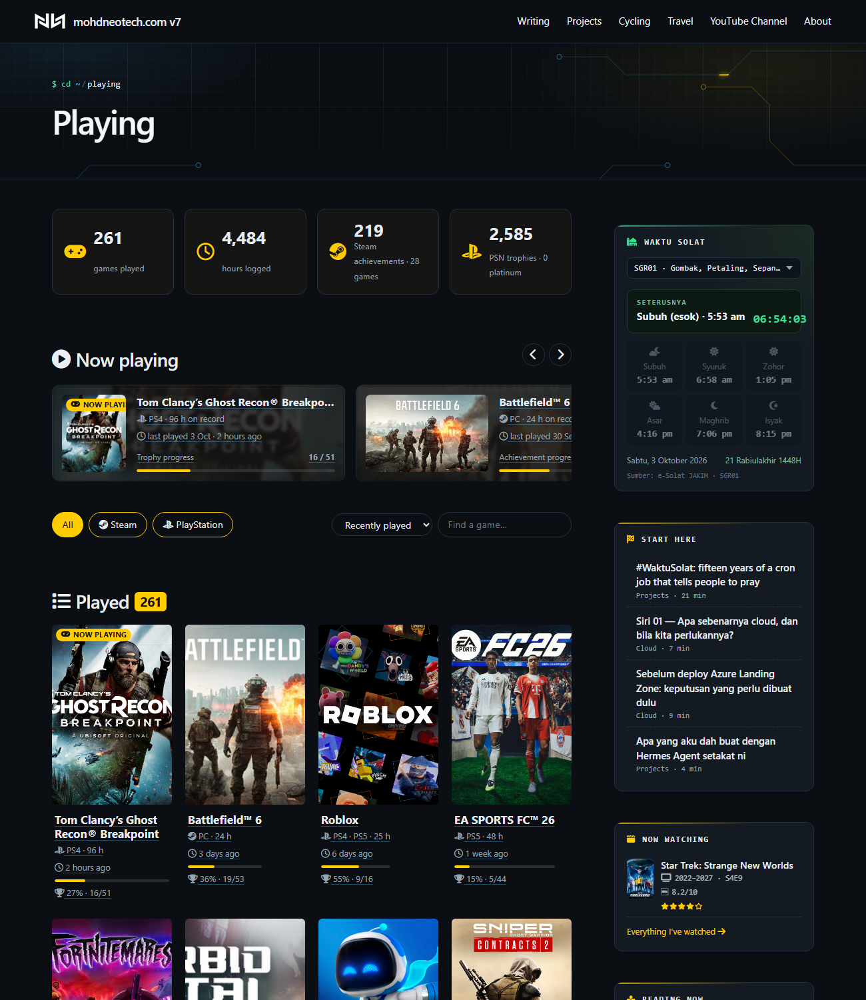

# NH Games — Steam & PlayStation Shelf for WordPress

Show every game you've played on **Steam** and/or **PlayStation** on your WordPress site — playtime, last played, achievements & trophies, a live **Now playing** badge, a sidebar widget and a full, paginated games page.

Only use one platform? Turn on just that one. You only enter details for the platforms you enable.

## Features

- **Steam** via the official Steam Web API — every played game, total playtime, last played, achievement progress, and a red **Live** badge while you're in-game.
- **PlayStation** (PS4 / PS5, plus PS3 & Vita through trophies) — playtime, sessions, first/last played, trophy breakdown (platinum / gold / silver / bronze). PS4 and PS5 versions of the same game are merged.
- **Now playing** — anything played in the last 48 hours (configurable), or games you pin by hand.
- **`[nh_games]` page** — stats strip, horizontal "Now playing" rail, platform filter, sort (recent / most played / completion / A–Z), search, and pagination.
- **`[nh_now_playing]` widget** — also available as a classic widget under *Appearance → Widgets*.
- **A page per game** at `/played/<game>/` with cover, stats, progress bar, store link and room for your own review and star rating.
- Auto-sync every 3 hours. Hide a game by setting it to **Draft** — syncing never republishes it.
- Accent colour + dark/light scheme setting, and optional widget CSS classes so it blends into your theme's sidebar.

## Install

1. Download the latest release zip from [Releases](../../releases) (or clone this repo into `wp-content/plugins/nh-games`).
2. *Plugins → Add New → Upload Plugin*, activate.
3. Go to **Settings → NH Games**, tick the platforms you use, and fill in their details.
4. Create a page (e.g. **Playing**) containing `[nh_games]`, and set its URL in the settings.
5. Add `[nh_now_playing]` (Shortcode block) or the **NH Games — Now playing** widget to your sidebar.

### Steam setup

1. Get a free Web API key at <https://steamcommunity.com/dev/apikey> (any domain name works).
2. Paste the key and your profile — a profile URL, your custom name from `steamcommunity.com/id/<name>`, or your 17-digit SteamID64.
3. In Steam: **Edit Profile → Privacy Settings** → set **My profile** and **Game details** to **Public**. Untick "Always keep my total playtime private".

### PlayStation setup

Sony doesn't offer a public API, so this uses the same PSN mobile endpoints as [psn-api](https://github.com/achievements-app/psn-api) and [psnawp](https://github.com/isFakeAccount/psnawp).

1. Sign in at <https://www.playstation.com>.
2. In the same browser, open <https://ca.account.sony.com/api/v1/ssocookie> and copy the `npsso` value.
3. Paste it into **NPSSO token** and save.

The NPSSO is exchanged for a refresh token immediately and **never stored**. The login lasts about two months and renews itself; when it lapses, wp-admin shows a notice and you paste a fresh NPSSO. Treat the NPSSO like a password — anyone holding it can act as you on PSN.

> ⚠️ PSN support relies on an unofficial API. It may break if Sony changes it, and it's used at your own risk.

## Shortcodes

| Shortcode | What it does |
|---|---|
| `[nh_games]` | The full games page |
| `[nh_now_playing count="3"]` | Sidebar widget |
| `[nh_game_more]` | "More I've played on …" strip — for a custom `single-nh_game` template |
| `[nh_game_crumbs class="…"]` | Terminal-style breadcrumb for a custom single-game template |

### Block themes

Game pages use your theme's normal single-post template. For a cleaner layout, create a template named **`single-nh_game`** in the Site Editor (or `templates/single-nh_game.html` in your theme) and drop in Post Content plus `[nh_game_more]`.

## Hooks

- `nhg_cpt_slug` — change the `/played/` base (flush permalinks after).
- `nhg_load_fontawesome` — return `false` to stop the plugin loading Font Awesome (it already skips this if your theme loads it).

## Requirements

WordPress 6.2+, PHP 8.0+. Outbound HTTPS from your server to `api.steampowered.com`, `store.steampowered.com`, `ca.account.sony.com` and `m.np.playstation.com`.

## Credits

Built by [Mohd Nordin Hussain](https://mohdneotech.com) for [mohdneotech.com/playing](https://mohdneotech.com/playing/). PSN endpoint research thanks to the psn-api, psn-php and psnawp projects.

Not affiliated with Valve or Sony Interactive Entertainment. Steam and PlayStation are trademarks of their respective owners.

## License

GPL-2.0-or-later
